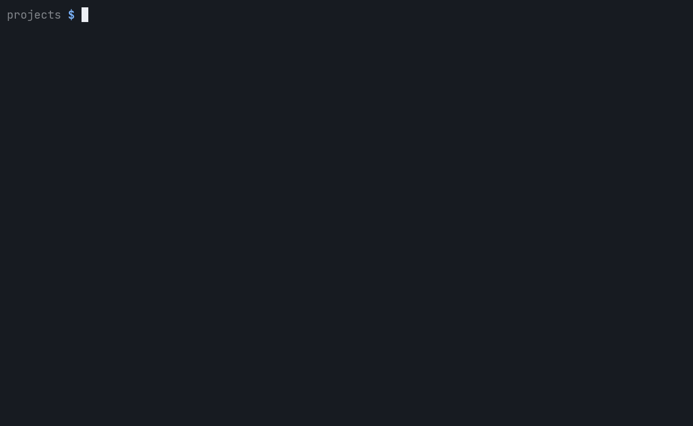
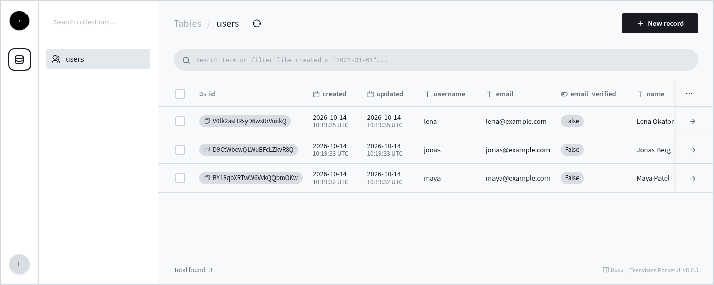
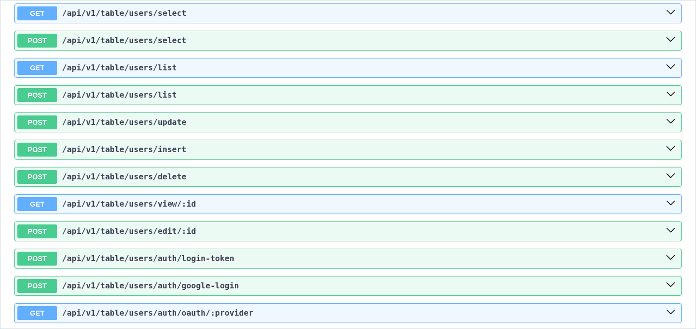
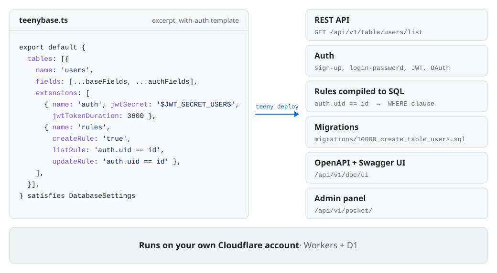

<div align="center">

  <h1>Teenybase</h1>

  <p><strong>A <small>tiny</small> backend for 🫵 next app.</strong></p>

  <p>
    <a href="https://www.npmjs.com/package/teenybase"></a>
    <a href="LICENSE"></a>
  </p>

  <p>
    <a href="https://teenybase.com">Website</a> &nbsp;&bull;&nbsp;
    <a href="docs/getting-started.md">Docs</a> &nbsp;&bull;&nbsp;
    <a href="docs/why-teenybase.md">Why Teenybase</a>
  </p>

</div>

One config file. REST API, auth, row-level security, auto-migrations, OpenAPI docs, admin panel. Serverless on Cloudflare Workers. Free to start.

## Your Entire Backend

```typescript
// teenybase.ts — this is your entire backend
import { DatabaseSettings, TableAuthExtensionData, TableRulesExtensionData, sqlValue } from 'teenybase'
import { baseFields, authFields, createdTrigger, updatedTrigger } from 'teenybase/scaffolds/fields'

export default {
  appUrl: 'http://localhost:8787',
  jwtSecret: '$JWT_SECRET',

  tables: [{
    name: 'users',
    autoSetUid: true,
    fields: [...baseFields, ...authFields],
    triggers: [createdTrigger, updatedTrigger],
    extensions: [
      { name: 'auth', jwtSecret: '$JWT_SECRET_USERS', jwtTokenDuration: 3600, maxTokenRefresh: 5 } as TableAuthExtensionData,
      {
        name: 'rules',
        createRule: 'true',
        viewRule: 'auth.uid == id',
        updateRule: 'auth.uid == id',
        deleteRule: 'auth.uid == id',
      } as TableRulesExtensionData,
    ],
  }, {
    name: 'posts',
    autoSetUid: true,
    fields: [
      ...baseFields,
      { name: 'author_id', type: 'relation', sqlType: 'text', notNull: true,
        foreignKey: { table: 'users', column: 'id' } },
      { name: 'title', type: 'text', sqlType: 'text', notNull: true },
      { name: 'body', type: 'text', sqlType: 'text' },
      { name: 'published', type: 'bool', sqlType: 'boolean', default: sqlValue(false) },
    ],
    triggers: [createdTrigger, updatedTrigger],
    extensions: [{
      name: 'rules',
      listRule: 'published == true | auth.uid == author_id',
      viewRule: 'published == true | auth.uid == author_id',
      createRule: 'auth.uid != null & author_id == auth.uid',
      updateRule: 'auth.uid == author_id & new.author_id == author_id',  // can't hand a post to someone else
      deleteRule: 'auth.uid == author_id',
    } as TableRulesExtensionData],
  }],
} satisfies DatabaseSettings
```

That config gives you a full blog API — user auth, JWT login, foreign keys, draft/published visibility rules, auto-migrations, OpenAPI docs, and an admin panel. No backend code, just a typed config object.

> [!NOTE]
> Teenybase is early (v0.1). Actively developed, API stabilizing. Good enough to ship side projects and MVPs, not yet proven for high-stakes production.

## Quick Start

<picture>
  <source media="(prefers-reduced-motion: reduce)" srcset="https://raw.githubusercontent.com/teenybase/teenybase/main/docs/images/quickstart.png">
  
</picture>

<sub>A real run of the commands below; the npm install, migration and server start-up waits are shortened.</sub>

```bash
npx teenybase create my-app --yes   # scaffold + npm install (template: with-auth)
cd my-app
npx teenybase deploy --local --yes  # generate and apply migrations to the local database
npx teenybase dev
```

Use `npx teenybase`, not `npx teeny`: the npm package named `teeny` is unrelated. Once teenybase is installed (in the project or with `npm i -g teenybase`), its CLI is also available as `teeny`.

Backend running at `localhost:8787`. Full REST API, auth endpoints, Swagger docs at `/api/v1/doc/ui`, admin panel at `/api/v1/pocket/`.

Deploy to your own Cloudflare account:

```bash
npx wrangler login                 # one-time: authenticate with Cloudflare
npx teenybase deploy --remote      # uses your login's account, creates the D1 database, uploads secrets, deploys
```

No Cloudflare account? `npx teenybase deploy --temporary` deploys to a temporary one: it prints the live URL and a claim link that keeps it if you sign in within 60 minutes. Details: [Try without an account](docs/getting-started.md#try-without-an-account-temporary-deploy).

Details: [Deploy to production](docs/getting-started.md#deploy-to-production-your-cloudflare-account).

## Using a Coding Agent?

Projects made with `create` or `init` include an `AGENTS.md` with the commands and the mistakes agents usually make, and the npm package ships the docs and three agent skills (`teenybase`, `teeny-rules`, `teeny-migrate`).

Add the skills to your agent (Claude Code, Codex, Cursor and others, via the [`skills`](https://github.com/vercel-labs/skills) CLI):

```bash
npx skills add teenybase/teenybase
```

Or, in Claude Code, install them as a plugin:

```
/plugin install teenybase --marketplace teenybase/teenybase
```

For the docs: `npx teenybase docs` lists the ones in your installed version (`node_modules/teenybase/docs/`), and [teenybase.com/llms.txt](https://teenybase.com/llms.txt) indexes the website docs.

## What You Get

Stop building these from scratch. They're included:

- **REST API** — CRUD endpoints for every table, automatically
- **Authentication** — email/password, JWT, OAuth (Google, GitHub, Discord, LinkedIn)
- **Row-level security** — rules like `auth.uid == owner_id`, compiled to SQL WHERE clauses
- **Auto-migrations** — change config, run one command, done
- **Actions** — server-side logic with typed params, callable via API
- **Full-text search** — SQLite FTS5, built in
- **File uploads** — object storage, per-field handling
- **OpenAPI docs** — auto-generated 3.1.0 spec + Swagger UI
- **Admin panel** — browse tables, view/edit records at `/api/v1/pocket/`. Two named roles (`viewer`, `editor`) with passwords in `.dev.vars` / `.prod.vars`; full admin by signing in with `ADMIN_SERVICE_TOKEN` as the password. The UI ([`@teenybase/pocket-ui`](https://www.npmjs.com/package/@teenybase/pocket-ui)) is a fork of the [PocketBase](https://github.com/pocketbase/pocketbase) admin dashboard (MIT, © Gani Georgiev)
- **Local dev** — the API, database and auth run locally with no Cloudflare account; Swagger UI and the admin panel load their pinned UI files from jsDelivr



<sub>The admin panel (<code>/api/v1/pocket/</code>) on a fresh with-auth project (the quick start template) after three sign-ups.</sub>

<details>
<summary>The generated Swagger UI (<code>/api/v1/doc/ui</code>) of that project</summary>



</details>

## How It Works

<picture>
  <source media="(prefers-color-scheme: dark)" srcset="https://raw.githubusercontent.com/teenybase/teenybase/main/docs/images/one-file-backend-dark.svg">
  
</picture>

Your schema is your backend. Define tables, fields, auth, and access rules in `teenybase.ts`. Teenybase generates migrations, builds the API, handles auth, enforces security rules, and serves docs. You deploy with one command.

Add a table. Run `teeny generate`. Run `teeny deploy`. It's live.

The config file is TypeScript with full IDE autocomplete and type checking. Paste it into any LLM and it knows your entire backend.

## Teenybase vs Others

| | Teenybase | Supabase | Firebase | PocketBase |
|---|---|---|---|---|
| **Defined in** | TypeScript config file | Dashboard + SQL | Dashboard + console | Admin UI |
| **Auth included** | Built in | Built in | Built in | Built in |
| **Row-level security** | API rules | SQL policies | Security rules | API rules |
| **Admin panel** | Built in | Dashboard | Console | Built in |
| **Runs on** | Cloudflare Workers + D1 (your account) | AWS (single primary) | Google Cloud | Self-hosted binary |
| **Open source** | Yes (Apache-2.0) | Yes (Apache-2.0) | No | Yes (MIT) |
| **Free tier** | 100k req/day, 500MB DB, 10GB files | 500MB DB, 1GB storage | 50K Firestore reads/day, 1 GiB Firestore, 10 GB hosting | Free (self-host) |
| **Self-hosting** | Your own Cloudflare account (no server to run) | Yes (complex) | No | Yes (single binary, needs a VPS) |
| **Deploy from CLI** | `teeny deploy` | Dashboard or CLI | Dashboard or CLI | Manual |
| **Config as code** | Everything in repo | Partial (migrations) | Partial | No |

Supabase and Firebase are full platforms with more features, bigger ecosystems, larger teams. PocketBase is beautifully simple. Teenybase sits in a specific spot: **everything defined in code, serverless on Cloudflare Workers, free to start, and you own it all.**

[Full comparison with trade-offs](docs/why-teenybase.md)

## What It Costs

Teenybase is free and open source. There is nothing to pay us. What you pay is Cloudflare's own bill for your account, and Cloudflare's free plan covers a lot.

**Cloudflare free plan:** 100,000 requests/day, 500 MB database, 10 GB file storage. No trial, no credit card. Prototypes and side projects run on it indefinitely.

**Cloudflare Workers Paid plan:** \$5/month base for your whole account. Each app's incremental usage is billed per request, per row read and per GB stored; there are no egress or bandwidth charges.

| What you're building | What you get | What Cloudflare charges |
|----------------------|--------------|-------------------------|
| Prototype / side project | 3M requests/month, 500 MB DB, 10 GB files | **\$0** (free plan) |
| App with real users (~1k DAU) | 500k requests/month, 5M row reads, 500 MB DB | **\$0** (fits the free plan); on Workers Paid, under \$1 on top of the \$5 base\* |
| Production SaaS (~10k DAU) | 5M requests/month, 50M row reads, 5 GB DB\*\*, 50 GB files | **\$5/month base + roughly \$1–5**\* |

*\*Cloudflare Workers Paid plan prices as of October 2026; [see the math](docs/cost-breakdown.md) and check [Cloudflare's pricing](https://developers.cloudflare.com/workers/platform/pricing/) for current numbers.*
*\*\*D1 max database size is 10 GB (hard limit). For most apps, 10 GB of SQLite holds millions of records. [Full limits](docs/why-teenybase.md#limits)*

> Teenybase itself is free. You pay only infrastructure costs, directly to Cloudflare.

[Full cost breakdown with working](docs/cost-breakdown.md) | [Full pricing comparison](docs/why-teenybase.md#what-it-costs) | [Infrastructure pricing](https://developers.cloudflare.com/workers/platform/pricing/)

## Documentation

- [Getting Started](docs/getting-started.md) — full setup walkthrough
- [Connecting Your Frontend](docs/frontend-guide.md) — fetch examples, auth flow, CRUD
- [Configuration Reference](docs/config-reference.md) — every option in teenybase.ts
- [Actions Guide](docs/actions-guide.md) — server-side logic
- [Recipes & Patterns](docs/recipes.md) — copy-paste examples for common use cases
- [Full App Recipe](docs/recipe-full-app.md) — full app example
- [CLI Reference](docs/cli.md) — all commands
- [API Endpoints](docs/api-endpoints.md) — endpoint reference
- [OAuth Guide](docs/oauth-guide.md) — provider setup
- [Existing Hono Projects](docs/existing-hono-project.md) — add teenybase to your app
- [Why Teenybase](docs/why-teenybase.md) — the full story
- [Security](docs/security.md) — what's protected, what's not, and how to report issues

## Requirements

- Node.js 22 or newer (wrangler 4 requires it)
- A Cloudflare account (Workers + D1) to deploy. Local development and `--temporary` deploys don't need one.

## Roadmap

Actively developed. See the [roadmap section in Why Teenybase](docs/why-teenybase.md#roadmap) for what's coming next.

## Contributing & Feedback

We want to hear about every bug and request.

- File issues at [github.com/teenybase/teenybase/issues](https://github.com/teenybase/teenybase/issues)
- PRs welcome — please open an issue first to discuss non-trivial changes. See [CONTRIBUTING.md](CONTRIBUTING.md)
- Report security issues privately, see [SECURITY.md](SECURITY.md)
- Release notes: [CHANGELOG.md](CHANGELOG.md)

## License

Apache-2.0
